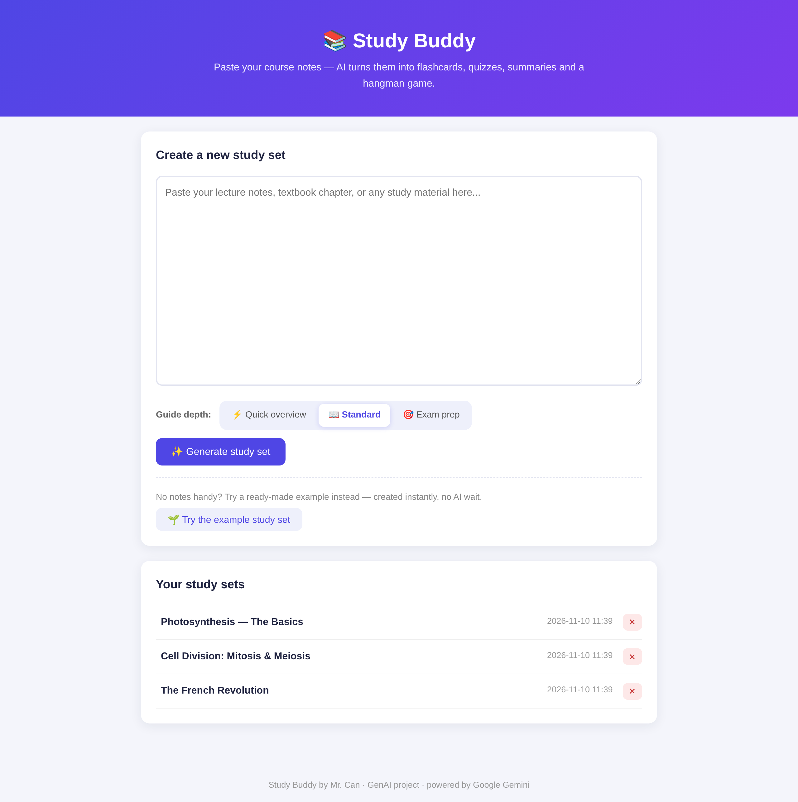
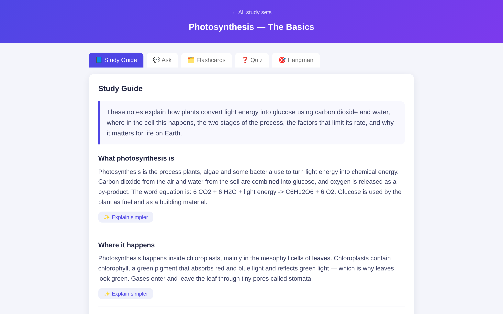
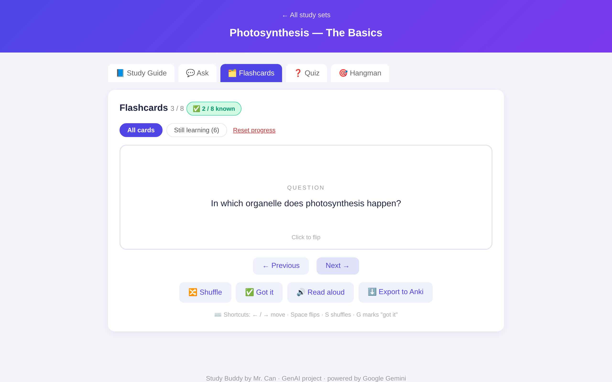
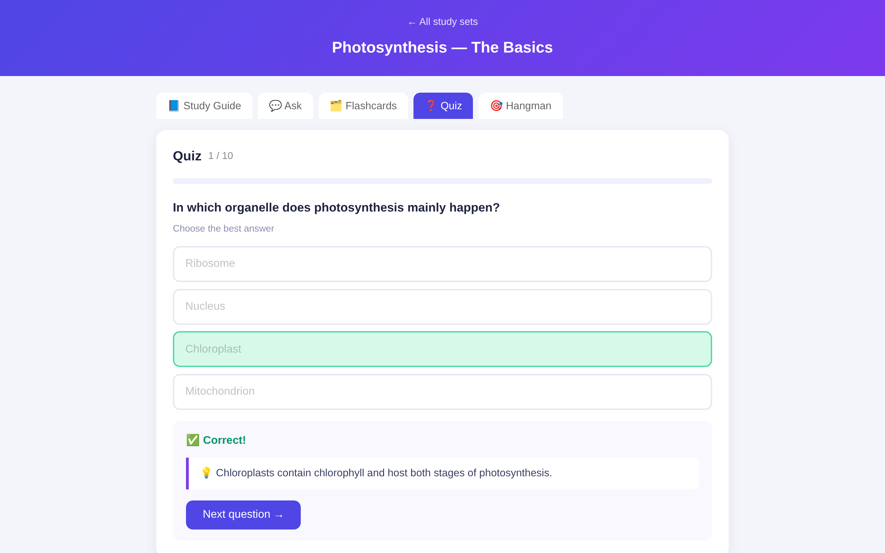
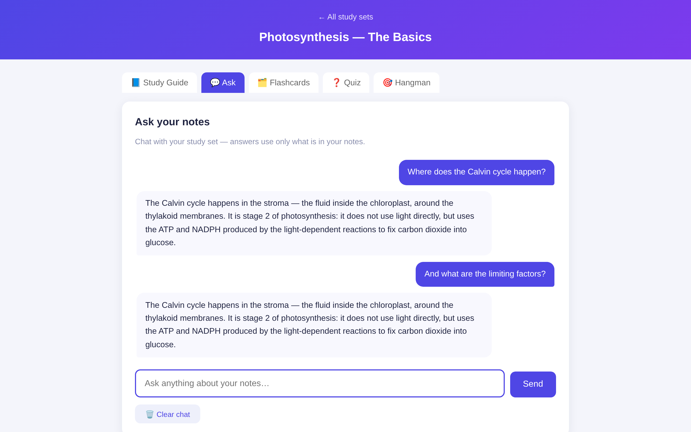
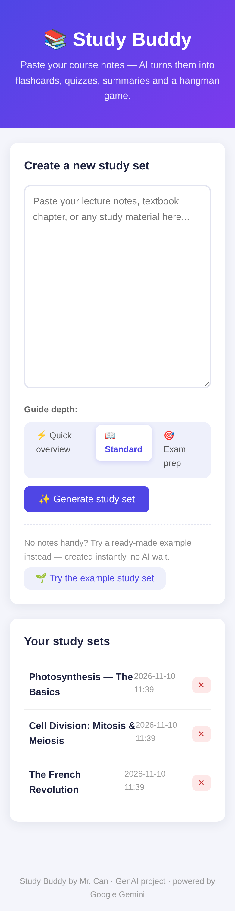
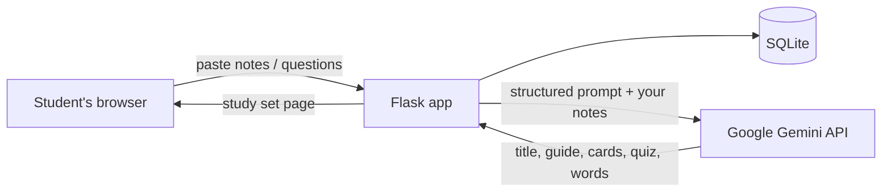

# 📚 Study Buddy

> Paste your course notes — get a structured study guide, flashcards, a mixed quiz, a hangman game and an AI chat that answers **from your notes**.


Study Buddy is a GenAI web app for students: paste any lecture notes or textbook chapter — in any language — and Google Gemini builds a complete study set from them. It was built as a GenAI course project, with the goal of making the AI the entire point of the app rather than an add-on.

The app was hosted on an AWS EC2 instance during the course; the code runs anywhere Python runs (see **Run it locally** below).

## Screenshots

| Home & study sets | Study guide |
|:---:|:---:|
|  |  |

| Flashcards with study tools | Quiz 2.0 |
|:---:|:---:|
|  |  |

| Ask your notes | Mobile |
|:---:|:---:|
|  |  |

## Features

- **Structured study guide** — an overview, titled sections, a key-term glossary, takeaways and study tips. Choose the depth on the home page (Quick overview / Standard / Exam prep) and have any section rewritten in simpler language with one click.
- **Ask your notes** — a chat that answers **only** from your pasted notes and says so honestly when they don't cover something. The conversation is remembered per study set and survives a page refresh.
- **Quiz 2.0** — exactly 10 questions mixing four formats: multiple choice, true/false, fill-in-the-blank (typo-tolerant) and matching. Every answer comes with an explanation of *why* it is correct, the end screen reviews all your answers, and your best score is saved.
- **Flashcards that adapt** — shuffle, keyboard shortcuts, "got it" tracking with a *Still learning* mode, read-aloud, and one-click export to Anki.
- **Hangman** — a word game built from the key terms of your notes.
- **Try the example** — a ready-made Photosynthesis study set, created instantly with **zero** AI calls, so the app can be demoed without pasting anything.
- **Privacy and safety** — study sets are private to each browser (signed session cookie), quiz totals are validated on the server, and API rate limiting protects the Gemini budget: 20 AI calls per visitor per hour, 60 per day, and a global cap of 300 per day — with a friendly message instead of a crash when a limit is hit.

## How it works



1. The student pastes notes on the home page (or clicks **Try the example**).
2. Flask sends the notes to the Gemini API with a prompt that asks for one structured JSON object: a title, a study guide, flashcards, quiz questions and hangman words — in the same language as the notes.
3. The response is validated item by item (broken quiz questions are skipped, never fatal) and saved in SQLite. The database upgrades itself automatically on start, so deploying a new version is just `git pull` + restart.
4. The study set page renders five study modes. All interactive logic (card flipping, quiz scoring, hangman, chat UI, read-aloud) runs in the browser with vanilla JavaScript — no build tools.
5. Two smaller AI calls power the extras: *Explain simpler* rewrites one guide section, and *Ask your notes* answers questions grounded in the notes with conversation memory. All three AI routes share the rate limiter.

## Technologies

| Layer | Choice | Why |
|---|---|---|
| Backend | Python + Flask | Simple, well documented, beginner friendly |
| GenAI | Google Gemini API (flash models, automatic fallback chain) | Free tier, reliable structured JSON output |
| Database | SQLite | Built into Python, no separate database server |
| Frontend | HTML / CSS / vanilla JavaScript | No build tools, easy to follow |
| Hosting | AWS EC2 — Ubuntu, gunicorn, systemd | Runs 24/7, restarts automatically if it crashes |

## Development process

This project was built in a **hybrid AI workflow** — a deliberate choice, since the course is about developing with GenAI: Claude (chat) for architecture and code, Antigravity (agentic IDE) for terminal commands and Git operations, and me verifying every step — reading error messages, checking commit contents, testing each feature. Working this way produced its own lessons, documented in [DEV_JOURNAL.md](DEV_JOURNAL.md).

**Phase 1 — Research.** Read the assignment requirements (GenAI as a central feature, hosting on AWS, code on GitHub, English documentation and video), chose an idea where the AI is obviously the entire point and which is easy to demonstrate on video, chose the tools (table above) and planned four phases: build locally → publish on GitHub → deploy on AWS → documentation and video.

**Phase 2 — Implementation.** Built the app file by file: Flask backend with SQLite, two HTML templates, game logic in JavaScript, styling in CSS. The first local run failed on a wrong model name (see Problems), then worked end-to-end. Added automatic retries for temporary API overload errors. Published to GitHub with `.env` (the secret API key) excluded via `.gitignore` and the commit file list verified manually before every push. Deployed on AWS EC2 (Ubuntu), first with Flask's development server, then switching to gunicorn as a systemd service.

**Phase 3 — Completion.** Tested the public link from PC and phone, and with an incognito window as a simulated second user — which revealed and fixed a real UX flaw: all visitors shared one study set history. Wrote the documentation and recorded the presentation video.

**Phase 4 — Feature iterations.** Four improvement steps, each built AI-assisted, tested locally against a mocked Gemini API, then deployed: (1) the structured study guide with depth levels and *Explain simpler*; (2) Quiz 2.0 with four question types, explanations and a saved best score; (3) the *Ask your notes* grounded chat; (4) quick wins (example deck, flashcard upgrades, Anki export, read-aloud) plus API rate limiting, and this README.

## Problems & solutions

**P:** The AI assistant claimed my Gemini API key was invalid (wrong prefix — outdated knowledge).
**S:** Verified against the Google AI Studio page instead of trusting the AI; the key was valid. Lesson: verify AI claims against the source.

**P:** Generation failed with 404 — model `gemini-2.0-flash` no longer exists.
**S:** Read the error message — it named the replacement. Later, a different model failed silently while others answered, diagnosed with a controlled experiment (direct request from server, from a second location, and via Google's List Models API). Result: a fallback chain of models so the app only fails if all are down.

**P:** API sometimes returned 503 "high demand".
**S:** Automatic retries with waits, plus layer timeouts designed together (requests 45 s < gunicorn worker 180 s).

**P:** The server returned an HTML error page that crashed the frontend's JSON parsing, hiding the real cause.
**S:** Read the server logs (`journalctl -u studybuddy`) — the root cause was gunicorn's default 30 s worker timeout killing workers mid-retry. Raised the timeout and made the frontend show a readable message for non-JSON responses.

**P:** Terminal commands failed — run in the wrong folder / PowerShell blocked the venv script.
**S:** Opened cmd directly in the project folder; learned that shell type and current folder matter on Windows.

**P:** Secret API key risk on public GitHub.
**S:** `.env` + `.gitignore` + `.env.example` pattern, and manual verification of every commit's file list.

**P:** All visitors shared one study set history (found while testing from two devices).
**S:** Per-visitor separation with Flask sessions and a database migration for existing data.

## What went well / what went badly

**Well:** the app works end-to-end and is genuinely useful; deployment is stable (survives reboots); the AI-assisted workflow was very productive for a beginner; every feature step was testable locally without spending API budget (mocked Gemini).

**Badly:** two AI-generated assumptions (API key format, model name) cost debugging time — both caught only because I verified against real sources — which is why every change is now verified by marker strings before committing.

## Conclusion

The project resulted in a working, publicly hosted GenAI application, and — just as valuable — practical experience in AI-assisted development: AI can draft an entire app, but verifying its output (error messages, credentials, cloud defaults, security) is the human's job, and that skill is what this project really taught me.

## Future improvements

Real user accounts (history across devices) · OCR upload for photos of notes · editing/regenerating individual cards · spaced-repetition scheduling for flashcards · HTTPS with a domain name.

## Run it locally

```bash
git clone https://github.com/suserista/study-buddy.git
cd study-buddy
python -m venv venv
venv\Scripts\activate        # Windows   (Mac/Linux: source venv/bin/activate)
pip install -r requirements.txt
```

Create a file `.env` next to `app.py` with your Gemini API key (get one free at [aistudio.google.com](https://aistudio.google.com)):

```ini
GEMINI_API_KEY=your-key
SECRET_KEY=any-long-random-string
```

Then run:

```bash
python app.py                # Mac/Linux: python3 app.py
```

and open <http://127.0.0.1:5000>. No database setup, no migrations to run, no other dependencies — SQLite is created and upgraded automatically on start.

## Project structure

```
study-buddy/
├── app.py              # Flask app: routes, Gemini prompts, rate limiting, DB migrations
├── example_deck.py     # pre-made demo study set (created with zero AI calls)
├── templates/
│   ├── index.html      # home page: paste notes, depth selector, example button
│   └── deck.html       # study set page: guide, chat, flashcards, quiz, hangman
├── static/
│   ├── style.css       # all styling (indigo/purple design language)
│   └── script.js       # all client logic: tabs, guide, chat, cards, quiz, hangman
├── screenshots/        # the screenshots shown above
├── .env.example        # template for the API key file (.env itself is git-ignored)
├── requirements.txt    # flask, requests, python-dotenv — nothing else
└── DEV_JOURNAL.md      # development log: problems, diagnosis, lessons
```

---

*Study Buddy by Mr. Can · GenAI project · powered by Google Gemini*
